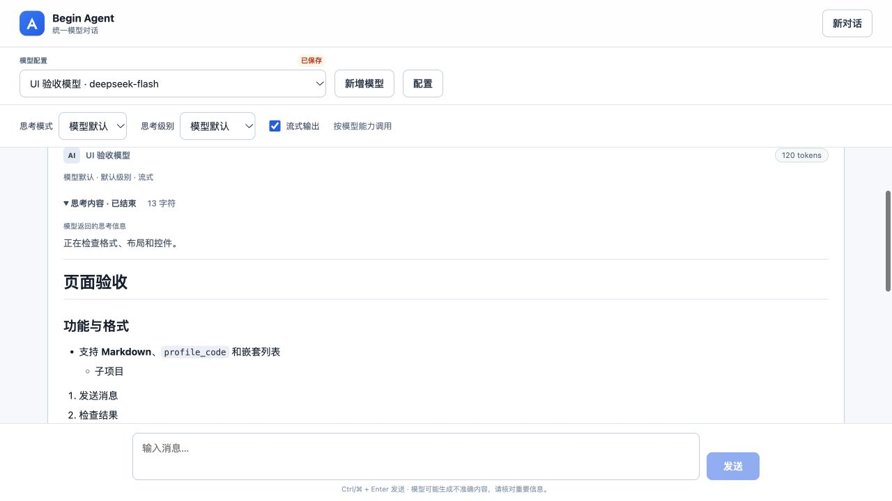
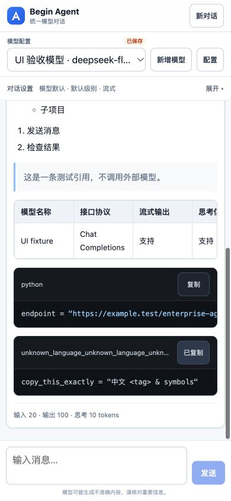

# 整页前端规范检查与修复

日期：2026-10-23（Asia/Shanghai）。依据 [前端开发规范](./frontend-standards.md)。

## 已发现并修复

| 问题 | 修复与验证 |
|---|---|
| 超长代码语言标签把代码工具栏撑高 | 单行省略，完整标签保留在 title；普通与超长标签工具栏均为 55px，复制按钮保持 40px、位于容器内 |
| 保存/验证配置期间字段仍可编辑，能切换入口 | 禁用表单字段、启用勾选和相关导航；增加忙碌说明与按钮状态；阻止重复提交 |
| 停用模型提示重新填密钥 | 明确显示已停用及启用/切换提示，禁用发送和相应请求参数控件 |
| 启用复选框与表单文本缺少统一对齐 | 40px 行内居中，16px 复选框中心偏差为 0 |
| 思考折叠标题点击区域偏矮、焦点样式未统一 | 40px 高、8px 圆角和统一键盘焦点，桌面/手机展开收起正常；规则检查器增加 summary 覆盖 |
| 保存忙碌文案可能被固定按钮宽度挤换行 | 按钮内容不换行，配置保存按钮按文案自适应宽度；实测保存中按钮 40px 高、文字单行 |

代码涉及 `App.vue`、`style.css`、`markdown.ts` 及 UI 检查脚本。新增页面交互回归测试，保留已有功能与原始 Markdown 请求历史。

## 自动检查

`make web-check`：**21 项测试通过**（15 项页面/Markdown 功能测试 + 6 项 UI 规则检查器测试），源码规范检查、Vue/TypeScript 类型检查和生产构建通过。

页面测试覆盖：停用配置、保存/验证时锁定、重复提交拒绝、停止保留部分正文且不重放为完整历史、流中错误和截断提示。Markdown 测试覆盖格式、高亮、长标签、复制及其失败状态和安全处理。

`ruff check web/tests/ui-audit-server.py`：通过。

## 真实浏览器验收

浏览器操作真实页面，边界场景通过独立测试服务提供模拟 API 响应；没有修改用户的 begin_agent 数据库，没有调用供应商 API。测试服务使用本次实际构建的前端文件，检查结束后已停止。复现方式：构建前端后运行 `python3 web/tests/ui-audit-server.py`，访问其本机地址。

最终构建覆盖六种视口：320×800、390×844、768×1024、1280×720、844×390、390×360。低高度场景不是实际手机软键盘实测。

六种尺寸均满足：

- 所有可见按钮、下拉框、思考折叠标题为 40px / 8px；同排底边差和 Logo 中心偏差均为 0。
- 页面没有横向溢出或额外纵向滚动；输入区在视口内。
- 128 字符长模型名、六列表格、长代码和超长语言标签均限制在卡片内；表格与代码可内部横向滚动。
- 复制按钮成功反馈可见。精确复制原文及失败回退由组件测试验证，未宣称浏览器剪贴板桥接的粘贴读取已通过。

桌面 1280×720 与手机 390×844 都实际操作并验证：HTTP 错误、流中错误、停止、截断、配置验证时锁定、配置保存时锁定、停用提示及思考内容折叠。错误与停止保留已返回的正文。

键盘 Tab 到按钮后有 2px 蓝色焦点轮廓；输入框焦点边框与外阴影一致。保存中按钮文字单行，复选框居中。配置表单自身滚动，不遮挡输入区。

另在实际应用 `127.0.0.1:18011` 打开并关闭配置表单：六个单行字段为 40px / 8px，API Key 不回显，输入区保持可见；未点击保存或真实接口验证。

数据：[整页几何和交互记录](./full-page-audit-results.json)、[思考折叠记录](./full-page-reasoning-audit.json)。

## 截图（独立测试响应）

