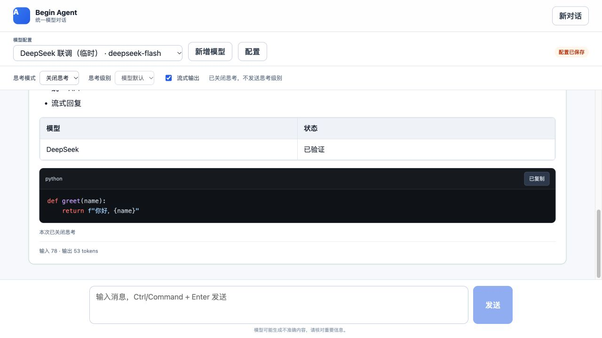

# 回复正文 Markdown 渲染验证

日期：2026-10-23（Asia/Shanghai）。

实现位置：`web/src/markdown.ts`、`web/src/components/MarkdownContent.vue`，由 `App.vue` 用于 assistant 正文，保持整块回复卡片布局。用户输入仍按原文展示，对话 API 和多轮历史仍传原始 Markdown 文本。

## 支持范围

- 标题、有序和无序列表、嵌套列表、表格和列对齐、引用、链接、行内代码。
- 围栏代码块及缩进代码块；常用语言高亮，标注语言，未知语言使用纯文本。
- 未闭合的流式代码围栏可正常显示，后续分片更新正文和可复制代码。
- 代码块一键复制原始代码，保留缩进、空行和特殊字符，提供成功或失败反馈。
- Clipboard API 不可用时尝试传统复制；失败不会显示“已复制”。
- 表格与长代码在回复卡片内横向滚动；超长代码块超过 50000 字符时按纯文本显示，避免高亮计算阻塞页面，仍可完整复制。
- 原始 HTML 不执行；生成 HTML 再经 DOMPurify 清理；危险链接不生成可执行链接。

## 自动化检查

`npm --prefix web test`：**8 项通过**。

覆盖语义 DOM、高亮、表格对齐、外链属性、恶意 HTML/脚本链接、代码特殊字符、多个块的复制目标、流式未闭合围栏、缩进代码、Clipboard API 失败后的回退与复制失败提示。

`npm --prefix web run build`：Vue 类型检查及生产构建通过。

## 浏览器检查

使用数据库中已配置的 DeepSeek，通过实际 SSE 接口返回 Markdown。确认标题、列表、表格、Python 高亮及复制按钮，点击复制后显示“代码已复制”。完整原文复制的内容断言由组件测试验证，浏览器自动化的粘贴桥接不支持读取页面写入的系统剪贴板，因此未将浏览器粘贴记为通过。

复制反馈的隐藏状态区域定位在正文容器内，避免长回复导致页面外层额外滚动。代码与表格在回复卡片中展示。

## 官方接口参考

- [Markdown-it 官方 API](https://markdown-it.github.io/markdown-it/)
- [Highlight.js Core API](https://highlightjs.readthedocs.io/en/latest/api.html)
- [DOMPurify 配置说明](https://github.com/cure53/DOMPurify#can-i-configure-dompurify)

最终浏览器 DOM 核对：1 个一级标题、2 个列表项、1 个表格、2 个 Python 关键字高亮节点；代码原文为 `def greet(name):` 加四空格缩进的 return 行及结尾换行。页面总高度与视口同为 720px，无额外外层滚动。截图：

