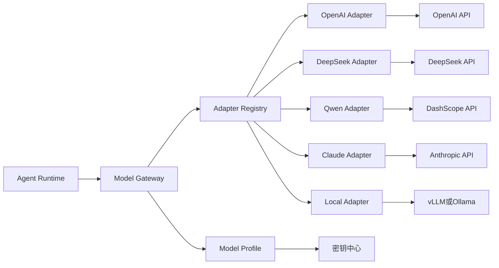
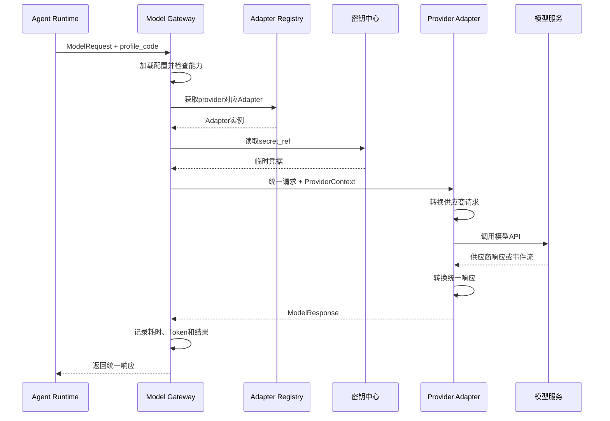
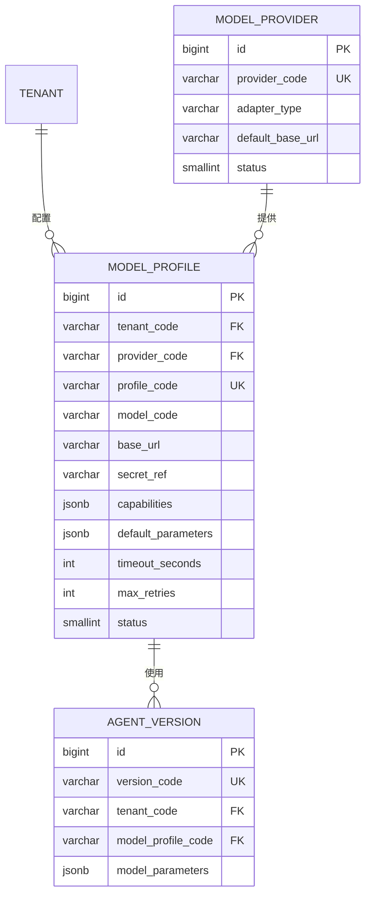

# 模型调用适配层设计

> 版本：V1.0\
> 适用范围：多租户、多 Agent 平台\
> 相关文档：[技术选型](./technology-selection.md) · [多租户多 Agent 平台 ER 设计](./multi-tenant-multi-agent-er-design.md)

## 当前落地范围

一期先解决“页面可以真实调用模型并持续对话”这一件事，已经实现：

```text
Vue 对话页
→ POST /api/v1/chat/stream
→ Model Gateway
→ OpenAICompatibleChatAdapter
→ DeepSeek / GLM / MiniMax / Kimi
```

- 四个供应商共用一个 OpenAI 兼容协议适配器，通过后端配置区分地址、默认模型和 API Key。
- 后端将供应商流转换成统一的 `start / reasoning / content / usage / done / error` 事件，以 SSE 返回页面。
- 页面保存本次会话的消息，并在下一轮请求时一并提交，实现多轮上下文。
- 当前不保存对话记录，不依赖数据库，也不包含 Agent Loop、工具调用、限流、重试和计费。
- API Key 只从后端环境变量读取，不发送给浏览器。

下文描述完整平台演进后的目标边界；超出上述范围的能力尚未实现，应按后续需求逐步增加。

## 1. 设计目标

平台需要接入 DeepSeek、OpenAI、通义千问、Claude 和企业本地部署模型。各模型的请求字段、消息格式、工具调用、流式事件、错误码和用量结构不同，不能让这些差异进入 Agent Runtime。

本方案在 Agent Runtime 与模型供应商之间增加模型调用防腐层：

```text
供应商协议
→ Provider Adapter
→ 平台统一模型协议
→ Agent Runtime
```

这里的“统一模型”是平台内部的领域对象和调用协议，不是指本地部署的大模型。

设计目标：

1. Agent Runtime 不依赖任何供应商 SDK 和数据类型。
2. 新增模型供应商时不修改 Agent Loop。
3. 统一消息、工具调用、流式事件、用量和异常。
4. 保留模型能力差异，不把所有模型限制在最低能力上。
5. 对模型调用实施统一的超时、限流、重试、审计和成本统计。

模型配置和调用链遵循项目统一标识规则：数据库 `id` 只作为内部主键，业务接口和实体关联全部使用不可变的 `*_code`。

## 2. 总体架构



各模块职责：

| 模块 | 职责 |
|---|---|
| Agent Runtime | 决定任务是否继续、是否调用工具以及何时退出 |
| Model Gateway | 选择模型、检查能力、执行超时重试、统计用量 |
| Adapter Registry | 根据 `provider_code` 返回对应适配器 |
| Provider Adapter | 在平台协议与供应商协议之间双向转换 |
| Model Profile | 保存租户可用的模型、端点、能力和默认参数 |
| 密钥中心 | 保存 API Key，数据库只保存引用 |

## 3. 分层边界

### 3.1 Agent Runtime

Agent Runtime 只使用平台统一类型：

```python
response = await model_gateway.generate(
    request=model_request,
    profile_code=agent_version.model_profile_code,
)
```

禁止在 Agent Runtime 中出现：

```python
from openai import AsyncOpenAI
from anthropic import AsyncAnthropic

if provider == "deepseek":
    ...
elif provider == "openai":
    ...
```

### 3.2 Model Gateway

Model Gateway 负责公共控制逻辑：

- 加载模型配置。
- 检查模型能力。
- 查找供应商适配器。
- 获取密钥引用。
- 执行超时、限流和重试。
- 记录调用尝试、耗时和 Token 用量。
- 将统一响应返回 Agent Runtime。

### 3.3 Provider Adapter

Provider Adapter 只负责协议差异：

- 将统一请求转换为供应商请求。
- 调用供应商 SDK 或 HTTP API。
- 将供应商流式事件转换为统一事件。
- 将结束原因、用量和错误转换为平台结构。

适配器不决定 Agent 是否重试，也不决定任务是否结束。

## 4. 统一调用接口

对话模型和 Embedding 模型使用两个接口，避免形成一个包含所有模型能力的庞大接口。

```python
from collections.abc import AsyncIterator
from typing import Protocol


class ChatModelAdapter(Protocol):
    async def generate(
        self,
        request: "ModelRequest",
        context: "ProviderContext",
    ) -> "ModelResponse":
        ...

    async def stream(
        self,
        request: "ModelRequest",
        context: "ProviderContext",
    ) -> AsyncIterator["ModelStreamEvent"]:
        ...


class EmbeddingModelAdapter(Protocol):
    async def embed(
        self,
        request: "EmbeddingRequest",
        context: "ProviderContext",
    ) -> "EmbeddingResponse":
        ...
```

## 5. 统一请求模型

```python
from typing import Any, Literal
from pydantic import BaseModel, Field


class TextPart(BaseModel):
    type: Literal["text"] = "text"
    text: str


class ImagePart(BaseModel):
    type: Literal["image"] = "image"
    url: str
    detail: Literal["low", "high", "auto"] = "auto"


class ToolResultPart(BaseModel):
    type: Literal["tool_result"] = "tool_result"
    tool_call_code: str
    content: Any
    is_error: bool = False


class ModelMessage(BaseModel):
    role: Literal["system", "user", "assistant", "tool"]
    content: list[TextPart | ImagePart | ToolResultPart]


class ToolDefinition(BaseModel):
    name: str
    description: str
    input_schema: dict[str, Any]


class ResponseFormat(BaseModel):
    type: Literal["text", "json_object", "json_schema"]
    json_schema: dict[str, Any] | None = None


class ModelRequest(BaseModel):
    messages: list[ModelMessage]
    tools: list[ToolDefinition] = Field(default_factory=list)
    temperature: float | None = None
    max_output_tokens: int | None = None
    response_format: ResponseFormat | None = None
    stop: list[str] = Field(default_factory=list)
    trace_context: dict[str, str] = Field(default_factory=dict)
```

`ModelRequest` 不包含 API Key、供应商客户端和供应商请求对象。

## 6. 统一响应模型

```python
class ToolCall(BaseModel):
    tool_call_code: str
    provider_tool_call_id: str | None = None
    name: str
    arguments: dict[str, Any]


class TokenUsage(BaseModel):
    input_tokens: int = 0
    output_tokens: int = 0
    total_tokens: int = 0
    cached_tokens: int | None = None


class ModelResponse(BaseModel):
    provider_request_id: str | None = None
    model: str
    content: str | None = None
    reasoning_content: str | None = None
    tool_calls: list[ToolCall] = Field(default_factory=list)
    finish_reason: Literal[
        "completed",
        "tool_call",
        "length",
        "content_filter",
        "cancelled",
        "error",
    ]
    usage: TokenUsage
    provider_metadata: dict[str, Any] = Field(default_factory=dict)
```

`provider_metadata` 只用于审计和问题定位，Agent Loop 不依赖其中的供应商私有字段。

## 7. 流式事件协议

只统一最终文本无法支持实时输出和增量 Tool Call，因此流式调用使用一组封闭事件：

```text
response_start
content_start
text_delta
reasoning_delta
tool_call_start
tool_call_arguments_delta
tool_call_end
usage
response_end
error
```

```python
class ModelStreamEvent(BaseModel):
    type: Literal[
        "response_start",
        "content_start",
        "text_delta",
        "reasoning_delta",
        "tool_call_start",
        "tool_call_arguments_delta",
        "tool_call_end",
        "usage",
        "response_end",
        "error",
    ]
    index: int | None = None
    data: dict[str, Any] = Field(default_factory=dict)
```

执行要求：

1. 每个内容块使用 `index` 标识。
2. Tool Call 参数接收完成后才能解析 JSON。
3. `usage` 必须在 `response_end` 前产生。
4. `response_end` 后不允许继续产生事件。
5. 被截断的 Tool Call 不进入工具执行器。
6. 流式事件组装完成后才能生成持久化的 `ModelResponse`。

## 8. 模型能力声明

统一协议不代表所有模型能力完全相同。每个模型配置必须声明能力：

```python
class ModelCapabilities(BaseModel):
    streaming: bool = True
    tool_calling: bool = False
    structured_output: bool = False
    vision: bool = False
    reasoning: bool = False
    prompt_cache: bool = False
    embedding: bool = False
    max_context_tokens: int
    max_output_tokens: int | None = None
```

Agent 发布和执行前进行能力校验：

```text
Agent配置了工具
→ 检查tool_calling
→ 支持则允许发布
→ 不支持则拒绝发布并说明原因
```

能力检查放在 Model Gateway，不由各 Adapter 临时决定。

## 9. 模型调用流程



## 10. 统一异常

```python
from enum import StrEnum


class ModelErrorCode(StrEnum):
    AUTH_FAILED = "AUTH_FAILED"
    RATE_LIMITED = "RATE_LIMITED"
    TIMEOUT = "TIMEOUT"
    CONTEXT_LENGTH_EXCEEDED = "CONTEXT_LENGTH_EXCEEDED"
    CONTENT_FILTERED = "CONTENT_FILTERED"
    MODEL_UNAVAILABLE = "MODEL_UNAVAILABLE"
    INVALID_REQUEST = "INVALID_REQUEST"
    CANCELLED = "CANCELLED"
    UNKNOWN = "UNKNOWN"


class ModelInvocationError(Exception):
    code: ModelErrorCode
    message: str
    retryable: bool
    provider_request_id: str | None
    retry_after_seconds: int | None
```

供应商错误统一转换示例：

| 供应商错误 | 平台错误 | 是否可重试 |
|---|---|---|
| HTTP 401/403 | `AUTH_FAILED` | 否 |
| HTTP 429 | `RATE_LIMITED` | 是 |
| 网络超时 | `TIMEOUT` | 是 |
| 上下文超长 | `CONTEXT_LENGTH_EXCEEDED` | 否 |
| 服务端5xx | `MODEL_UNAVAILABLE` | 是 |
| 用户取消 | `CANCELLED` | 否 |

## 11. 超时、重试与降级

Model Gateway 负责调用策略：

```text
一次Agent模型调用
└── Attempt 1
    ├── 成功：返回
    └── 可重试错误
        └── Attempt 2
            ├── 成功：返回
            └── 失败：结束或按策略切换备用模型
```

一期规则：

- 默认最多重试一次。
- 只对超时、限流和服务不可用重试。
- 使用指数退避，并遵守供应商 `Retry-After`。
- 身份错误、参数错误、内容过滤和上下文超长不重试。
- 模型切换必须由配置明确授权，不能静默切换。
- 每次尝试单独记录，防止把两次调用成本合并成一次。
- 重试前检查任务总超时和 Token 预算。

## 12. 配置与数据模型

一期使用两张配置表。

### 12.1 `model_provider`

平台级供应商和适配器定义：

```text
id
provider_code          OPENAI / DEEPSEEK / QWEN / CLAUDE / LOCAL
provider_name
adapter_type
default_base_url
status
created_at
updated_at
```

### 12.2 `model_profile`

租户实际可使用的模型配置：

```text
id
tenant_code
provider_code
profile_code
display_name
model_code
base_url
secret_ref
capabilities           JSONB
default_parameters     JSONB
timeout_seconds
max_retries
status
created_at
updated_at
```

`agent_version` 增加：

```text
model_profile_code
model_parameters       JSONB
```

关系如下：



关键约束：

```text
UNIQUE (profile_code)
```

## 13. 安全要求

- API Key 存入密钥中心，数据库只保存 `secret_ref`。
- 日志不得记录完整 API Key、完整系统提示词和敏感工具结果。
- 调用模型前根据租户和 Agent 权限检查 `model_profile`。
- 外部模型调用必须设置连接超时和响应超时。
- 自定义 `base_url` 需要平台管理员审核，避免访问内部敏感地址。
- 模型输入在发送前执行敏感字段过滤或脱敏。
- 模型响应落库前执行日志脱敏。

## 14. 可观测性

每次调用至少记录：

```text
tenant_code
task_code
run_code
step_code
provider_code
model_code
attempt_no
provider_request_id
started_at
finished_at
latency_ms
input_tokens
output_tokens
cached_tokens
finish_reason
error_code
```

日志和指标使用这些字段关联，但不在普通日志中输出完整消息正文。

## 15. 推荐代码结构

```text
app/
├── runtime/
│   └── agent_loop.py
├── model_gateway/
│   ├── domain/
│   │   ├── request.py
│   │   ├── response.py
│   │   ├── stream_event.py
│   │   ├── capabilities.py
│   │   └── errors.py
│   ├── ports/
│   │   ├── chat_model.py
│   │   └── embedding_model.py
│   ├── adapters/
│   │   ├── openai_adapter.py
│   │   ├── deepseek_adapter.py
│   │   ├── qwen_adapter.py
│   │   ├── claude_adapter.py
│   │   └── local_adapter.py
│   ├── registry.py
│   ├── gateway.py
│   ├── stream_assembler.py
│   └── retry_policy.py
```

## 16. 新增模型的开发步骤

新增供应商时只需要：

1. 实现 `ChatModelAdapter` 或 `EmbeddingModelAdapter`。
2. 完成请求、响应、流式事件和异常转换。
3. 声明模型能力。
4. 在 `AdapterRegistry` 注册 `provider_code`。
5. 增加适配器契约测试。
6. 创建对应的 `model_provider` 和 `model_profile` 配置。

不需要修改 Agent Loop、工具执行器和任务状态机。

## 17. 测试要求

每个 Adapter 使用同一套契约测试：

- 普通文本响应。
- 流式文本响应。
- 单个和多个 Tool Call。
- Tool Call 参数分片。
- JSON 结构化输出。
- Token 用量转换。
- 超时和用户取消。
- 429、5xx 和认证失败。
- 上下文超长。
- 不完整流和中途断开。

集成测试使用供应商测试账号或可控的本地模拟服务，不在单元测试中调用真实收费接口。

## 18. 一期实施范围

一期只实现：

1. `ChatModelAdapter` 统一接口。
2. DeepSeek Adapter。
3. 一个 OpenAI 兼容协议 Adapter，用于接入兼容接口和本地模型。
4. 文本、流式文本和 Tool Call。
5. 统一异常、超时和一次重试。
6. Token 用量与调用耗时记录。
7. `model_provider`、`model_profile` 两张配置表。

多模态、Embedding、自动故障切换、复杂价格计算和动态负载路由在实际业务需要时再增加。

## 19. 设计结论

模型调用适配层采用“统一领域协议 + Model Gateway + Provider Adapter”的结构：

```text
Agent Runtime
→ Model Gateway
→ Provider Adapter
→ 外部或本地模型服务
```

Agent Runtime 只理解平台内部的 `ModelRequest`、`ModelResponse` 和 `ModelStreamEvent`。供应商协议、SDK、鉴权和错误格式都限制在 Adapter 内部。新增模型主要增加 Adapter 和配置，不修改 Agent Loop。
