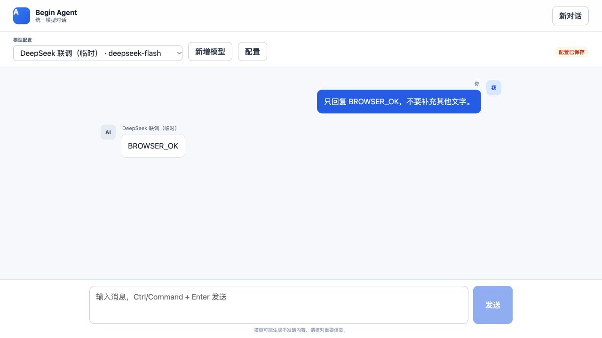
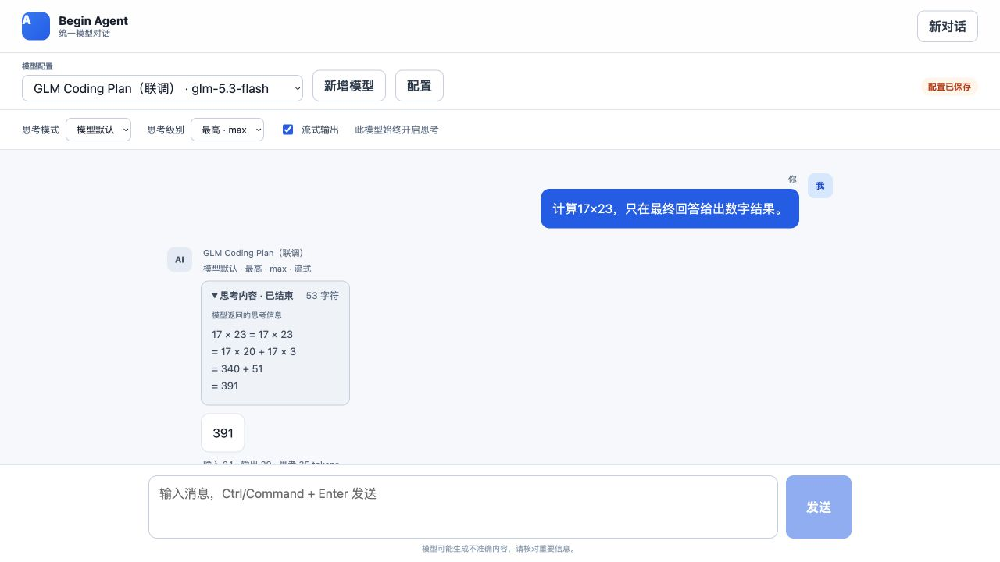

# 四家模型 API 适配与验证报告

核对日期：2026-10-23（Asia/Shanghai）。

## 结果

| 供应商 | 独立适配与协议测试 | 真实 API 验证 | 当前范围与依据 |
|---|---|---|---|
| DeepSeek | 通过 | **通过** | deepseek-flash；文本、多轮推理回传、流式、工具调用及结果回传 |
| GLM | 通过 | **通过** | glm-5.3-flash；Coding Plan 专用端点；文本、多轮、流式、工具调用及结果回传 |
| MiniMax | 通过 | **待验证** | 尚未保存可用密钥；不能据模拟测试宣称真实调用成功 |
| Kimi | 通过 | **待验证** | 尚未保存可用密钥；不能据模拟测试宣称真实调用成功 |

机器可读结果：[真实验证记录](./model-provider-live-verification.json)。报告包含状态、请求 ID、结束原因和用量，不包含 API Key、完整消息或凭据密文。

## 实现内容

- 四家分别实现请求参数和错误策略，共用 HTTP/SSE 传输内核。
- 支持文本与流式调用，完整保留多轮消息中的 reasoning_content 和工具调用。
- 处理工具参数分片、最终 message 帧去重、缓存与推理 Token、业务错误码及异常结束原因。
- 取消和总超时会关闭上游连接；不自动重放已输出的流，不把断流当作完成。
- 模型配置通过页面录入，API Key 加密写入 PostgreSQL，修改时留空保留原密钥；密钥与加密主密钥分开存放。
- 列表、保存响应、参数校验错误和日志不回显密钥；不跟随重定向或向非官方地址转发凭据。
- 生成的工具调用由调用方决定是否执行；本项目尚无完整 Agent Loop 和业务工具执行器。

## 自动化验证

命令：

```bash
TEST_DATABASE_URL=postgresql+asyncpg://begin_agent@127.0.0.1:55487/postgres pytest -q --disable-warnings
ruff check app tests scripts migrations
cd web && npm run build
```

结果：**102 项测试通过，无跳过；Ruff 通过；Vue 类型检查与前端构建通过**。

测试使用真实的隔离 PostgreSQL 16，并以 MockTransport 模拟模型服务。因此，数据库集成通过与真实供应商验证通过是两类结论。

主要覆盖：

- 四家请求地址、Bearer 认证、请求体字段与特有参数；
- 非流式响应、文本和推理分片、中文跨字节与多行 SSE；
- 工具参数组装、非法 JSON 拒绝、截断工具调用不暴露；
- HTTP 401/403/429/5xx、HTTP 200 业务错误、GLM 异常 finish_reason；
- 超时、主动取消、流中错误、断流、结束后异常数据、不转发重定向；
- 数据库密文、配置修改与停用、主密钥重启读取、错误主密钥拒绝；
- 配置 API 不回显密钥、非本机配置写入保护；
- 配置 API → PostgreSQL → 网关 → 四家适配器 → SSE/JSON 的完整链路（模型端为模拟）。

Alembic 迁移 `20261023_01` 已分别在隔离测试库和用户指定的本地 `begin_agent` 库执行通过。本地数据库使用开发环境配置的账号。

## DeepSeek 真实调用

使用用户授权的临时密钥，通过本机配置 API 加密入库；调用过程中只从数据库解密到内存。

执行：

```bash
python -m scripts.verify_model_providers --output docs/model-provider-live-verification.json
```

五次请求组成四项检查：一次文本、一次多轮追问、一次流式、一次工具调用、一次工具结果回传。当前全部通过。另外已在真实浏览器中发送请求并收到 `BROWSER_OK`，验证了 Vue → FastAPI → 数据库配置 → DeepSeek → SSE → 页面展示。截图见下方。MiniMax、Kimi 没有已启用配置，分别记为 BLOCKED，未发送带假密钥的请求。

临时模型配置保留在数据库，供用户测试后移除或在页面停用；没有将供应商密钥写入源码、文档或供应商环境变量。

## 官方协议依据

通过 agent-reach 网页阅读方式获取官方文档，而非按兼容地址猜测：

- [DeepSeek Chat Completions](https://api-docs.deepseek.com/api/create-chat-completion/)：思考开关、工具选择限制、流式结束与用量。
- [GLM 对话补全](https://docs.bigmodel.cn/api-reference/模型-api/对话补全)、[GLM-5.3-Flash](https://docs.bigmodel.cn/cn/guide/models/vlm/glm-5.3-flash)、[GLM 错误码](https://docs.bigmodel.cn/cn/api/api-code)：温度、保留推理、tool_stream 和失败结束原因。
- [MiniMax OpenAI SDK](https://platform.minimax.io/docs/api-reference/text-openai-api)、[Chat Completion](https://platform.minimax.io/docs/api-reference/text-chat-openai)：adaptive thinking、推理分离、输出长度与最终 message。
- [Kimi 模型参数](https://platform.kimi.com/docs/api/models-overview)、[Chat Completions](https://platform.kimi.com/docs/api/chat)：K3/K2.x 参数差异和完整历史消息回传。

## 实际限制

- 当前确认 DeepSeek 默认型号的上述调用场景通过；其他型号、多模态和供应商托管工具不在本次验证范围。
- MiniMax、Kimi 的真实接口仍需要各自可用配置。配置表单的“已保存”不会显示成“已验证”。单次“测试已保存配置”只检查文本请求，不替代完整验证脚本。
- 当前管理保护不是完整租户鉴权；模型配置表用于本机开发阶段，公开部署前仍需接入用户与租户权限。


## GLM Coding Plan 真实调用

使用用户授权的 Coding Plan 密钥加密入库，模型为 `glm-5.3-flash`，端点为 `https://open.bigmodel.cn/api/coding/paas/v4`，未使用普通按量端点。

五次真实请求完成文本、多轮推理回传、SSE 流式与工具调用/结果回传四项检查，全部 PASSED。结果已合并到总报告，详细记录见 [GLM Coding Plan 实测](./glm-coding-plan-live-verification.json)。未重跑已通过的 DeepSeek 请求。

接口依据：[智谱官方 Coding Plan 接入工具](https://docs.bigmodel.cn/cn/coding-plan/tool/others)。

## 浏览器真实验证截图



## 思考级别、流式开关与思考内容

新增对话控件与思考面板；配置列表返回具体型号能力。自动化测试枚举已覆盖的七种型号，检查页面宣告的模式、级别组合与适配器实际参数校验一致，覆盖两种输出方式。数据库集成测试确认 `reasoning_effort=max` 实际进入四家的上游请求，非流式与流式均保留思考信息。

真实应用接口验证记录：[generation-live-verification.json](./generation-live-verification.json)。2026-10-23 的结果：

| 模型 | 真实检查 | 结果 |
|---|---|---|
| DeepSeek deepseek-flash | low 流式、high 非流式、max 流式；关闭思考的流式与非流式 | 5 项通过 |
| GLM glm-5.3-flash / Coding Plan | low 流式、high 非流式、max 流式 | 3 项通过 |
| MiniMax / Kimi | 无已启用的数据库配置 | BLOCKED，不宣称真实验证完成 |

每项启用思考的真实请求均返回非空思考信息、完整结束和正确的 `391`；流式正文和思考分片拼接与最终响应逐字一致。DeepSeek 关闭思考后两种模式均无思考信息。记录用量与请求 ID，不保存密钥。该检查验证参数接收与返回协议，不保证不同题目或级别的 Token 用量单调递增。

浏览器另行验证：DeepSeek low 流式思考及折叠、关闭思考时级别自动清空并禁用、非流式返回 `NONSTREAM_OK`；切换 GLM 后不提供关闭思考选项，max 流式返回思考面板、正文与思考 Token。每份配置的会话和控件状态分别保留。


