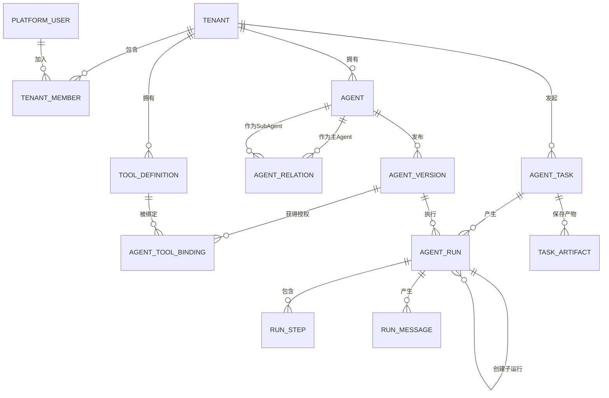
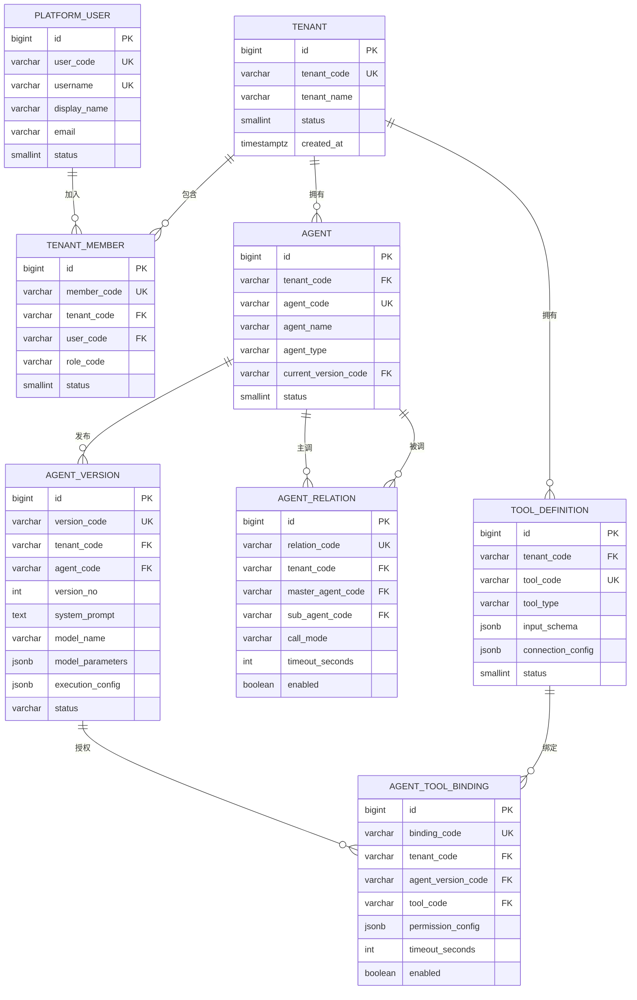
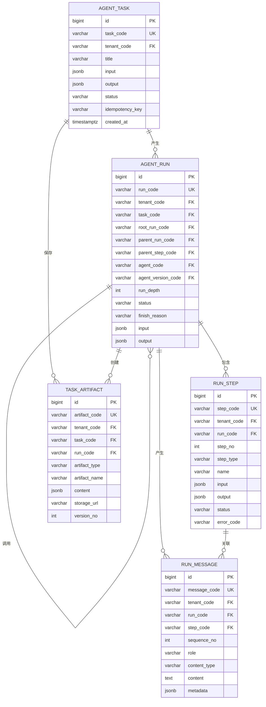
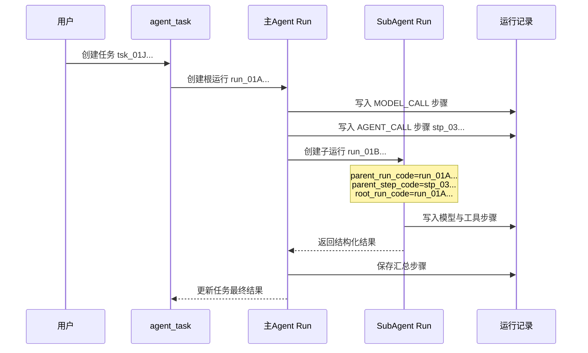

# 多租户多 Agent 平台 ER 设计

> 版本：V1.0\
> 数据库：PostgreSQL 16\
> 设计目标：支持多租户、Agent 版本管理、主 Agent 调用 SubAgent、工具调用和完整执行追踪。
>
> 相关文档：[技术选型](./technology-selection.md) · [模型调用适配层设计](./model-adapter-design.md)

## 1. 设计范围

一期数据模型只解决四件事：

1. 租户、用户和基础角色管理。
2. Agent 定义、版本发布和调用关系配置。
3. 用户任务、Agent 执行和父子调用链记录。
4. 工具授权、执行步骤、消息和任务产物追踪。

工作流引擎、计费中心、复杂评测、Agent 自由通信暂不进入一期核心模型。

## 2. 建模原则

- 使用一个 PostgreSQL 数据库和共享数据表。
- 所有租户业务表必须包含 `tenant_code`。
- Agent 执行必须绑定不可变的 `agent_version`，历史执行不读取最新配置。
- 一次用户请求对应一个 `agent_task`，每调用一次 Agent 对应一个 `agent_run`。
- 主 Agent 调用 SubAgent 时，通过 `parent_run_code` 和 `parent_step_code` 建立父子链路。
- 执行日志采用追加写，已完成的步骤不做覆盖更新。
- 常用检索字段使用普通列，变化较快的模型参数和步骤输入输出使用 `JSONB`。
- 密钥只保存密钥中心引用，不在数据库中保存明文。

### 2.1 实体标识规则

所有实体同时具有内部主键和实体编码，两者职责严格分离：

| 字段 | 用途 |
|---|---|
| `id` | 数据库内部代理主键，只服务于存储，不进入API、业务规则、日志和实体关联 |
| `*_code` | 实体不可变唯一编码，用于API、实体关联、业务逻辑、审计和链路追踪 |
| `*_name` | 可修改的展示名称，不能用于实体关联 |

统一规则：

- `id` 使用数据库生成的 `BIGINT IDENTITY`。
- 实体编码使用“类型前缀 + ULID”，例如 `agt_01J...`、`run_01J...`。
- 实体编码全局唯一、创建后不可修改、删除后不得复用。
- 关联字段保存目标实体编码，例如 `agent_version.agent_code`。
- 所有外部接口只接收和返回实体编码，不暴露内部 `id`。
- 租户业务表必须同时保存 `tenant_code`，用于隔离、索引和RLS策略。

编码示例：

```text
ten_01J...   租户
usr_01J...   用户
agt_01J...   Agent
agv_01J...   Agent版本
tsk_01J...   任务
run_01J...   运行
stp_01J...   执行步骤
tol_01J...   工具
```

## 3. 总体 ER 图



## 4. 配置域 ER 图



## 5. 运行域 ER 图



## 6. 核心表说明

### 6.1 `tenant`

平台租户。租户停用后，禁止新建任务和运行 Agent，但历史数据仍可查询。

| 字段 | 类型 | 约束 | 说明 |
|---|---|---|---|
| id | BIGINT | PK | 数据库内部主键，不参与业务 |
| tenant_code | VARCHAR(40) | UK | 不可变实体编码 |
| tenant_name | VARCHAR(128) | NOT NULL | 租户名称 |
| status | SMALLINT | NOT NULL | 1启用，0停用 |
| created_at | TIMESTAMPTZ | NOT NULL | 创建时间 |
| updated_at | TIMESTAMPTZ | NOT NULL | 更新时间 |

### 6.2 `platform_user` 与 `tenant_member`

用户与租户为多对多关系。`tenant_member` 一期只保存 `PLATFORM_ADMIN`、`TENANT_ADMIN`、`MEMBER` 三种角色。

`platform_user.user_code` 是用户唯一编码，`tenant_member.member_code` 是成员关系实体自身的唯一编码。成员关系通过 `tenant_code` 和 `user_code` 关联两端实体。

关键约束：

```text
UNIQUE (tenant_code, user_code)
```

### 6.3 `agent`

保存 Agent 的身份和当前发布版本，不保存运行时快照。

| 字段 | 类型 | 说明 |
|---|---|---|
| id | BIGINT | 数据库内部主键，不参与业务 |
| tenant_code | VARCHAR(40) | 所属租户编码 |
| agent_code | VARCHAR(40) | Agent不可变唯一编码 |
| agent_name | VARCHAR(128) | 展示名称 |
| agent_type | VARCHAR(32) | `NORMAL`、`SUPERVISOR`、`ROUTER` |
| current_version_code | VARCHAR(40) | 当前发布版本编码，可为空 |
| status | SMALLINT | 启用状态 |

关键约束：

```text
UNIQUE (tenant_code, agent_code)
```

### 6.4 `agent_version`

保存发布时确定的提示词、模型、参数和执行限制。已发布版本不可修改，只能创建新版本。

每个版本拥有独立的 `version_code`，运行记录通过 `agent_version_code` 引用它。`version_no` 只用于同一 Agent 下的版本展示和排序。

`execution_config` 示例：

```json
{
  "max_steps": 10,
  "timeout_seconds": 300,
  "max_sub_agent_calls": 5,
  "max_depth": 2,
  "max_tokens": 30000
}
```

关键约束：

```text
UNIQUE (version_code)
UNIQUE (tenant_code, agent_code, version_no)
```

### 6.5 `agent_relation`

声明主 Agent 可以调用哪些 SubAgent。`call_mode` 支持：

- `SERIAL`：串行调用。
- `PARALLEL`：允许并行调用。
- `ON_DEMAND`：由主 Agent 根据任务判断是否调用。

关键约束：

```text
UNIQUE (tenant_code, master_agent_code, sub_agent_code)
CHECK (master_agent_code <> sub_agent_code)
```

保存关系时还需要在服务层检查循环依赖。

### 6.6 `tool_definition` 与 `agent_tool_binding`

工具定义属于租户，工具授权绑定到具体 Agent 版本。这样可以保证历史版本使用的工具权限不发生变化。

`permission_config` 示例：

```json
{
  "allowed_operations": ["order.query"],
  "data_scope": "CURRENT_DEPARTMENT"
}
```

### 6.7 `agent_task`

表示用户或业务系统提交的一件完整任务。重复请求通过 `(tenant_code, idempotency_key)` 拦截。

任务状态：

```text
PENDING → RUNNING → SUCCEEDED
                  → FAILED
                  → CANCELLED
                  → TIMEOUT
```

### 6.8 `agent_run`

表示某个 Agent 的一次执行。主 Agent 和所有 SubAgent 都使用同一张表。

| 字段 | 作用 |
|---|---|
| root_run_code | 整条 Agent 调用链的根运行 |
| parent_run_code | 创建当前运行的父运行 |
| parent_step_code | 父 Agent 在哪一步调用当前 Agent |
| run_depth | 当前调用深度，从0开始 |
| agent_version_code | 本次实际执行的不可变版本 |
| finish_reason | 本次运行的退出原因 |

`finish_reason` 统一使用：

```text
COMPLETED
MAX_STEPS
MAX_DEPTH
TIMEOUT
BUDGET_EXCEEDED
TOOL_FAILED
MODEL_FAILED
CANCELLED
NO_PROGRESS
```

### 6.9 `run_step`

记录 Agent Loop 的每一步，是问题排查和执行回放的主要依据。

`step_type` 使用：

```text
CONTEXT_BUILD
MODEL_CALL
TOOL_CALL
AGENT_CALL
ROUTE_DECISION
RESULT_PROCESS
HUMAN_APPROVAL
```

关键约束：

```text
UNIQUE (run_code, step_no)
```

一期将工具请求、响应和耗时保存在 `run_step.input`、`run_step.output` 中，不额外拆分工具调用表。

### 6.10 `run_message`

保存实际进入模型上下文的消息和模型返回消息。消息在落库前完成敏感字段脱敏。

`role` 使用：

```text
SYSTEM
USER
ASSISTANT
TOOL
```

### 6.11 `task_artifact`

保存多个 Agent 共享的中间结果和最终文件，例如检索资料、SQL 查询结果、分析结论和生成报告。二进制文件进入对象存储，表中只保存 `storage_url` 和元数据。

## 7. 主 Agent 调用 SubAgent 的落库过程



示例数据关系：

```text
Task tsk_01J...
└── Run run_01A...：主 Agent，run_depth=0
    ├── Step 1：MODEL_CALL
    ├── Step 2：ROUTE_DECISION
    ├── Step 3：AGENT_CALL
    │   └── Run run_01B...：数据查询 SubAgent，run_depth=1
    │       ├── Step 1：MODEL_CALL
    │       ├── Step 2：TOOL_CALL
    │       └── Step 3：RESULT_PROCESS
    └── Step 4：MODEL_CALL，汇总最终结果
```

## 8. 租户隔离

具体采用以下方案：

```text
共享 PostgreSQL 数据库
+ 共享数据表
+ 每张业务表包含 tenant_code
+ 服务端从登录态解析 tenant_code
+ DAO 层自动追加 tenant_code 条件
+ PostgreSQL RLS 作为第二道保护
```

执行要求：

1. 禁止客户端自由传入可信的 `tenant_code`。
2. 创建、查询、更新和删除都必须带租户条件。
3. 关联查询同时校验两侧记录属于同一租户。
4. 缓存键必须使用实体编码，例如 `agent:{tenantCode}:{agentCode}`。
5. 对象存储路径必须使用实体编码，例如 `tenant/{tenantCode}/task/{taskCode}`。

## 9. 核心索引

```sql
CREATE UNIQUE INDEX uk_agent_code
    ON agent (agent_code);

CREATE UNIQUE INDEX uk_agent_version
    ON agent_version (tenant_code, agent_code, version_no);

CREATE UNIQUE INDEX uk_agent_version_code
    ON agent_version (version_code);

CREATE UNIQUE INDEX uk_agent_relation
    ON agent_relation (tenant_code, master_agent_code, sub_agent_code);

CREATE UNIQUE INDEX uk_task_idempotency
    ON agent_task (tenant_code, idempotency_key)
    WHERE idempotency_key IS NOT NULL;

CREATE INDEX idx_task_created
    ON agent_task (tenant_code, created_at DESC);

CREATE INDEX idx_run_task
    ON agent_run (tenant_code, task_code, created_at);

CREATE INDEX idx_run_parent
    ON agent_run (tenant_code, parent_run_code);

CREATE UNIQUE INDEX uk_run_step_no
    ON run_step (run_code, step_no);

CREATE INDEX idx_message_run
    ON run_message (tenant_code, run_code, sequence_no);
```

## 10. 一期表清单

| 分类 | 表 | 是否必需 |
|---|---|---|
| 租户 | tenant | 必需 |
| 租户 | platform_user | 必需 |
| 租户 | tenant_member | 必需 |
| Agent | agent | 必需 |
| Agent | agent_version | 必需 |
| Agent | agent_relation | 必需 |
| 工具 | tool_definition | 必需 |
| 工具 | agent_tool_binding | 必需 |
| 运行 | agent_task | 必需 |
| 运行 | agent_run | 必需 |
| 运行 | run_step | 必需 |
| 运行 | run_message | 必需 |
| 产物 | task_artifact | 按业务加入 |

## 11. 暂不纳入一期的模型

以下能力等核心执行链稳定后再增加：

- 工作流：`workflow`、`workflow_version`、`workflow_node`、`workflow_edge`。
- 异步事件：`outbox_event`、`event_subscription`、`event_delivery`。
- 评测：`evaluation_case`、`evaluation_run`、`evaluation_result`。
- 计量：`usage_record`、`quota_policy`、`billing_record`。
- 人工审批：`approval_instance`、`approval_record`。

这套核心模型已经能够支持单 Agent、主 Agent 调度多个 SubAgent、串行或并行调用、工具使用、完整链路查询和租户数据隔离。
