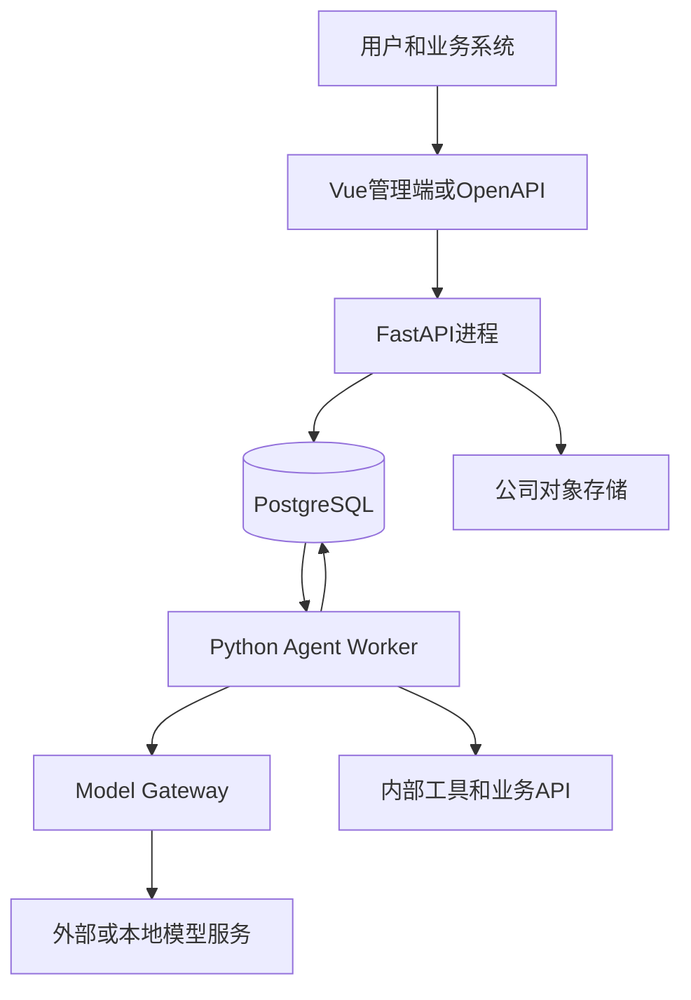

# 企业级 Agent 平台技术选型

> 版本：V1.0\
> 目标：用较少的技术组件完成一个可开发、可测试、可部署的多租户、多 Agent 平台。\
> 相关文档：[数据模型设计](./multi-tenant-multi-agent-er-design.md) · [模型调用适配层设计](./model-adapter-design.md)

## 1. 选型结论

| 分类 | 选择 | 用途 |
|---|---|---|
| 后端语言 | Python | 平台接口、Agent Runtime、工具调用 |
| API框架 | FastAPI | 管理端接口和任务接口 |
| 数据校验 | Pydantic | API、模型和工具参数校验 |
| ORM | SQLAlchemy | PostgreSQL数据访问 |
| 数据迁移 | Alembic | 数据库结构版本管理 |
| 主数据库 | PostgreSQL | 租户、Agent、任务和运行记录 |
| 向量检索 | pgvector，按需启用 | 初期知识库检索 |
| 异步执行 | Python asyncio | 模型、工具和SubAgent并发调用 |
| 一期任务队列 | PostgreSQL任务表 | 任务领取、租约和重试 |
| 文件存储 | 公司对象存储 | 文档、附件和生成文件 |
| 管理端 | Vue 3 + TypeScript | Agent配置、测试和运行查询 |
| 部署 | Docker | API托管前端静态文件，Worker独立运行 |

一期核心组合：

```text
Vue管理端
+ Python FastAPI
+ Python Agent Worker
+ PostgreSQL
+ 公司对象存储
```

## 2. 部署结构



API和Worker使用同一个代码仓库和领域模型，作为两个独立进程部署：

```text
API进程：租户、Agent配置、版本发布、任务创建、运行查询
Worker进程：任务领取、Agent Loop、SubAgent调度、模型和工具调用
```

## 3. 为什么选择 Python

Agent平台的主要耗时来自模型调用、知识检索和外部工具调用，属于I/O密集型任务。Python适合这一运行特点。

选择理由：

1. 大模型和Agent相关SDK完整。
2. `asyncio`适合并行调用模型、工具和SubAgent。
3. FastAPI和Pydantic能够快速构建类型明确的接口。
4. API、Worker和Agent Runtime使用同一种语言，减少一期部署和排障成本。
5. 后续接入文档解析、Embedding和模型评测比较方便。

Python不承担本地大模型推理。需要GPU推理时，通过Model Gateway调用独立的vLLM、Ollama或公司模型服务。

## 4. 为什么选择 PostgreSQL

平台数据以关系型业务数据为主：

```text
租户 → 用户
Agent → Agent版本
主Agent → SubAgent
Agent版本 → 工具权限
Task → Run → RunStep
```

选择理由：

1. 适合管理租户、权限、版本和执行链等关系数据。
2. JSONB可以保存模型参数、工具参数和执行结果。
3. RLS可以作为租户行级隔离的第二道保护。
4. 递归CTE可以查询完整的主Agent与SubAgent调用树。
5. pgvector可以承担初期知识库向量检索。
6. 一期可以使用`SKIP LOCKED`实现任务领取，减少独立消息队列。

数据存储方式：

| 数据 | 存储方式 |
|---|---|
| 租户、Agent、版本、状态、时间 | PostgreSQL普通字段 |
| 模型参数、工具参数、步骤输入输出 | PostgreSQL JSONB |
| 初期知识向量 | pgvector |
| 文档和生成文件 | 对象存储，数据库保存地址和元数据 |

如果公司已经统一使用MySQL并具备成熟运维体系，可以继续使用MySQL，核心数据模型保持不变。对于从零建设的项目，PostgreSQL能够用更少组件覆盖当前需求。

## 5. 一期任务执行方案

一期不单独部署消息队列，Worker从PostgreSQL领取任务：

```sql
SELECT id
FROM agent_task
WHERE status = 'PENDING'
  AND scheduled_at <= now()
ORDER BY priority DESC, created_at
FOR UPDATE SKIP LOCKED
LIMIT 1;
```

任务需要保存：

```text
locked_by
locked_at
lease_expires_at
retry_count
next_retry_at
```

Worker异常退出后，其他Worker可以在租约过期后重新领取任务。模型调用期间不保持数据库长事务。

## 6. 后端框架选择

### FastAPI与Pydantic

- 提供管理接口和任务接口。
- 使用Pydantic统一校验API参数、工具参数和内部模型协议。
- 原生支持异步接口，适合模型流式输出。

### SQLAlchemy与Alembic

- SQLAlchemy管理关系数据和事务。
- Repository层统一注入`tenant_code`条件。
- 数据库`id`只作为内部主键，接口、关联和业务逻辑统一使用不可变实体编码。
- Alembic记录数据库结构变更，禁止手工修改生产表结构。

### Agent Runtime

Agent Runtime由平台自行维护，核心接口包括：

```text
AgentRuntime
ModelGateway
ToolExecutor
AgentDispatcher
ContextBuilder
```

外部Agent框架可以参考或局部使用，但任务、Run、RunStep和退出条件必须保留在平台自己的领域模型中。

## 7. 前端与部署

管理端使用Vue 3和TypeScript，主要页面包括：

- 租户成员管理。
- Agent配置和版本发布。
- 主Agent与SubAgent关系配置。
- 在线调试和测试用例。
- Task、Run和RunStep查询。
- 模型及工具配置。

前端只参与开发和镜像构建。`npm run build` 将产物输出到 `app/static/`，由 FastAPI 直接托管。生产运行时不再启动独立的 Node、Nginx 或 Web 容器，页面与 API 使用同一域名。

API和Worker分别构建Docker镜像或使用同一镜像的不同启动命令：

```text
python -m app.api
python -m app.workers.agent_worker
```

一期可以部署：

```text
API × 2
Worker × 2
PostgreSQL主备或公司数据库服务
```

## 8. 一期不引入的组件

一期暂不引入：

- Redis
- MongoDB
- Elasticsearch
- ClickHouse
- 专用向量数据库
- 独立工作流引擎
- 独立消息队列

这些组件不能因为“以后可能用到”而提前加入。

## 9. 后续扩展条件

| 出现的问题 | 扩展方案 |
|---|---|
| 数据库任务领取产生明显锁竞争 | 接入公司消息队列 |
| 热点配置频繁访问数据库 | 增加Redis缓存 |
| RunStep统计影响在线事务 | 同步到ClickHouse |
| 运行日志需要复杂全文检索 | 增加Elasticsearch或OpenSearch |
| pgvector无法满足检索延迟或规模 | 引入专用向量数据库 |
| 工作流需要大量条件、等待和人工节点 | 增加独立工作流模块 |

扩展必须由监控数据和业务需求触发。

## 10. 推荐项目结构

```text
begin_agent/
├── app/
│   ├── api/                 # FastAPI接口
│   ├── domain/              # Agent、Task、Run领域模型
│   ├── services/            # 应用服务
│   ├── repositories/        # 数据访问和租户过滤
│   ├── runtime/             # Agent Loop
│   ├── orchestration/       # 主Agent与SubAgent调度
│   ├── model_gateway/       # 模型防腐层
│   ├── tools/               # 工具适配
│   ├── workers/             # 任务执行进程
│   └── models/              # SQLAlchemy模型
├── migrations/              # Alembic迁移
├── tests/
└── pyproject.toml
```

## 11. 选型结论

平台一期采用Python作为统一后端语言，FastAPI提供管理和任务接口，Python Worker执行Agent Loop与多Agent调度，PostgreSQL保存核心业务和运行数据。

这套方案的重点是：

```text
统一语言
+ 单一主数据库
+ API与Worker分进程
+ 模型供应商通过防腐层接入
+ 出现实际瓶颈后再增加基础组件
```
